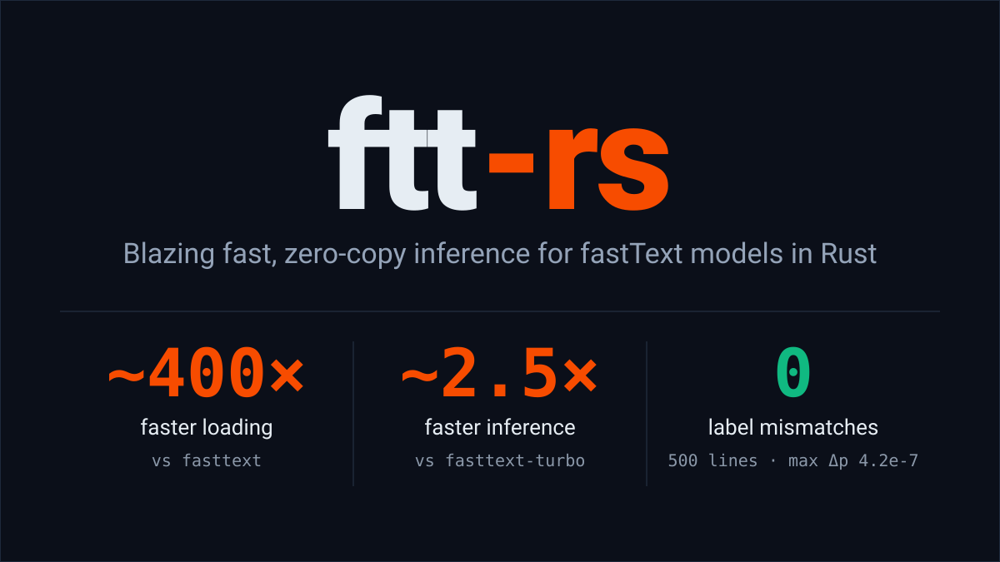

<div align="center">
  <h1>ftt-rs</h1>
  <p>A blazing fast, memory-mapped inference engine for <a href="https://fasttext.cc/">fastText</a> models<br>inspired by <a href="https://github.com/CommonGlot/fastText-turbo">fasttext-turbo</a> (their <a href="https://commonglot.github.io/blog/fasttext-turbo.html">research</a>), written from scratch in Rust</p>
  
</div>

<hr>

## Quick start

### Library

```rust
use ftt_rs::{Model, PredictOptions};

fn main() -> ftt_rs::Result<()> {
    let model = Model::load("model.bin")?;
    let opts = PredictOptions::k(3).with_threads(8);

    // one line
    for p in model.predict("Hello, how are you?", &opts)? {
        println!("{}\t{:.6}", p.label, p.probability);
    }

    // multiline batched and parallel, results in input order
    let lines = ["bonjour", "привет", "你好"];
    let all = model.predict_batch(&lines, &opts)?;
    for row in all {
        for p in row {
            print!("{} {:.6}  ", p.label, p.probability);
        }
        println!();
    }
    Ok(())
}
```

byte input:

```rust
let preds = model.predict_bytes(b"hello \xff world", &PredictOptions::k(1))?;
```

for high-throughput callers, `predict_batch_bytes_into` writes all results into one reusable flat vector plus one length per line:

```rust
let mut flat = Vec::new();
let mut lengths = Vec::new();
model.predict_batch_bytes_into(&lines_as_bytes, &opts, &mut flat, &mut lengths)?;
```

for a tight loop of single-line predictions, reuse a `Predictor`. It keeps the feature, hidden-vector and score buffers alive:

```rust
let mut predictor = model.predictor()?;
for line in lines {
    let preds = predictor.predict(line, &PredictOptions::k(1))?;
}
```

more code examples can be found in [examples](./examples/) dir

### CLI

We provide a fasttext-compatible CLI

```bash
ftt predict model.bin input.txt 1 0.0 8
ftt predict-prob model.bin input.txt 5
ftt predict-prob model.bin - 1 0.0 8 < input.txt

ftt bench model.bin input.txt -threads 8 -repeat 3
ftt info model.ftz
ftt features model.bin "hello world"
```

## Why it's fast

fastText prediction is dominated by two costs — reading random embedding rows and multiplying the hidden vector by the output matrix — and this engine attacks both.

- **Zero-copy model** with `mmap`ed file.
- **Per-word row sums**. Char n-grams give each word dozens of constant-sum rows, lazily precomputed on first prediction for frequent words. +40–55% throughput on n-gram-heavy models.
- **On-demand features, exact hash**. Character n-grams computed from input bytes with fastText's signed-byte FNV-1a hash and UTF-8 boundary rules
- **Cache-blocked batch scoring**: skinny GEMM `scores[batch, labels] = hidden[batch, dim] * W[labels, dim]ᵀ`, labels outer and eight lines at a time inner, so a 1 KB label row is read once per batch not once per line
- **AVX2 + FMA, runtime dispatch**. Uses eight independent accumulators, NEON on Apple silicon and aarch64, portable scalar path always available, no `-march=native`, one binary everywhere
- **Best-first hierarchical softmax**. the Huffman tree is walked toward the more probable child first, so the top-k heap fills early with high-probability leaves. ~20–50% at `k=1`, ~10% at `k=5` on one core
- **Vectorized softmax denominator\***. Only labels above single-precision contribution are summed, exp is vectorized, selected labels re-scored with `exp`
- **Prefetched row gathers**. Prefetches run several rows ahead as a sentence averages hundreds of scattered 1 KB rows, roughly doubling this memory-bound step
- **Parallel batches**. A worker needs ≥128 lines, small batches stay single-threaded
- **Single-pass feature extraction**: tokenization, cache lookup, word n-grams and feature rows in one token pass; in-vocabulary words add a cached sum without materializing subword ids
- **Zero-copy, allocation-light CLI**: input `mmap`ed into borrowed line slices, predictions in one flat reusable buffer with per-line lengths, reusable small-`k` array with heap fallback; within ~10% of library throughput.

You can set the word cache size with the env variable `FASTTEXT_TURBO_WORD_CACHE_MB` (default: `32`)

\* The softmax denominator cutoff shifts probabilities by under 1e-6

## Compatibility and correctness

Supported model files:

| Feature                                | Status                             |
| -------------------------------------- | ---------------------------------- |
| File format v12 (and v11)              | yes                                |
| Supervised models                      | yes                                |
| Softmax, one-vs-all, negative sampling | yes                                |
| Hierarchical softmax                   | yes                                |
| Character n-grams and word n-grams     | yes                                |
| Quantized input (`input.ftz`, qnorm)   | yes                                |
| Quantized output (`qout`)              | yes                                |
| Pruned n-gram dictionary               | yes                                |
| Unsupervised models                    | loaded, but prediction is rejected |
| Training / quantization                | out of scope                       |

On the real `lid.176.ftz` (quantized hierarchical softmax, 42,765
pruned n-grams, 176 labels) a 500-line run over mixed multilingual text gives **0 label mismatches, max 4.2e-7**

The Python API appends a newline to every string, so an end-of-sentence token is included by default; `append_eos: false` (or `--no-eos`) predicts the raw line without it

## Benchmarks

Internal benchmarks were run on the following setup:

- Windows 11
- AMD Ryzen 7 PRO 3700 (8 cores / 16 threads)
- 32 GB RAM

Used `common_wide` custom set with 53636 sentences from FLORES200. In total set counts 51 languages. The language subfamilies are united.

- for [lid176](https://fasttext.cc/docs/en/language-identification.html) inference **~2.5x faster** than fasttext-turbo, model loading **~40х faster** than fasttext-turbo (**~400х faster** than fasttext), memory usage **~2x lower** than fasttext (~1.5x higher than fasttext-turbo)
- for [GlobLID v4](https://github.com/cisnlp/GlotLID) inference **~1.25x faster** than fasttext-turbo (**~1.1x faster** than fasttext), model loading **~40x faster** than fasttext-turbo (**~150x faster** than fasttext and **~13x faster** than fasttext-rs), memory usage **~1.25x less** than fasttext (roughly comparable to fasttext-rs and only 5-10% more than fasttext-turbo (c++))


## Building and testing

```bash
cargo test --release           # unit tests + reference fixtures
cargo check --target aarch64-unknown-linux-gnu   # cross-check NEON paths
cargo build --release
```

Fixtures are committed under `tests/data/`; regenerate them (requires Python 3.9–3.12 with `fasttext`) with:

```bash
python scripts/make_fixtures.py
```

The optional external-model test runs when `FASTTEXT_TURBO_MODEL` is set:

```bash
FASTTEXT_TURBO_MODEL=/path/to/lid.176.ftz cargo test --release optional_external_model
```
